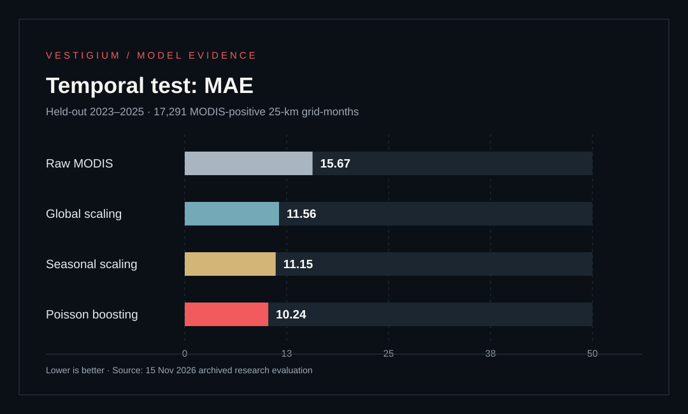
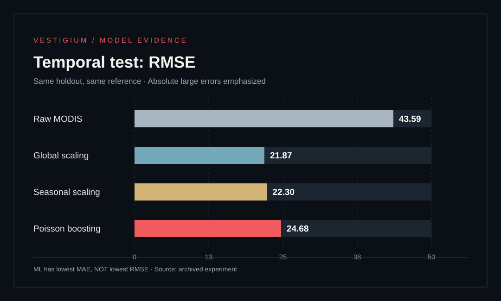
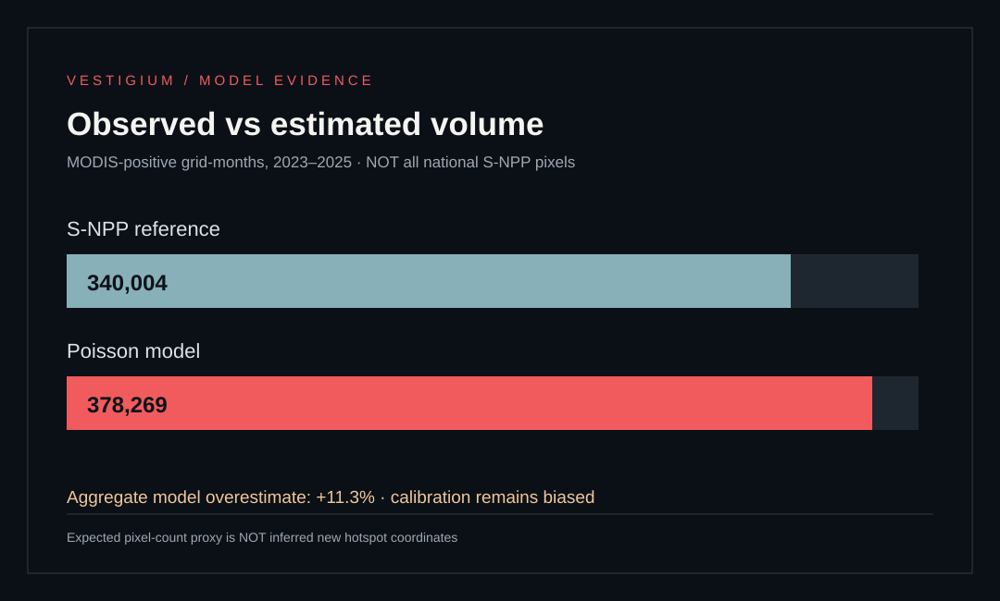
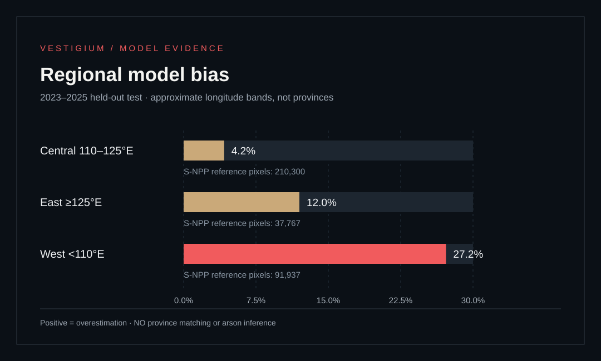
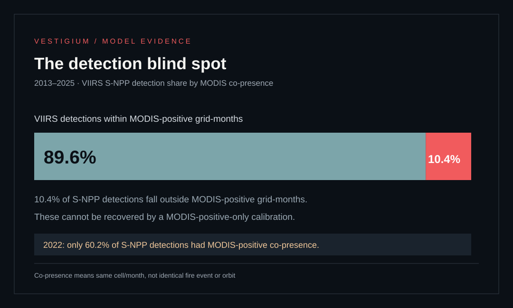

# Model Card & Evidence: MODIS → VIIRS S-NPP

**VESTIGIUM · NASA Space Apps Challenge 2026 · Team Ga Tidur**

**Model status:** Experimental harmonization baseline, not a verified count of wildfires.

**Evidence provenance:** Archived full-dataset harmonization experiment produced 15 November 2026 and documented in [HARMONIZATION_REPORT.md](../HARMONIZATION_REPORT.md). The repo's restructured Python training source has been tested on a synthetic end-to-end fixture in GitHub Actions, but **its current code has not been rerun against all 5,997,676 source records as part of this repository migration**. These figures are **not newly generated holdout metrics for the modified current training code**.

## Scientific question

Can MODIS thermal-anomaly detected-pixel counts be calibrated to approximate the spatial-temporal **VIIRS S-NPP detected-pixel count scale** during shared observation years? This experiment estimates the reference count only for **monthly EPSG:6933 25-km cells in which MODIS has at least one detection**. It does **not** reconstruct pixel-level VIIRS hotspot positions or unique fire events.

NASA documents MODIS active fire pixel resolution at roughly 1 km versus 375 m for VIIRS; the higher-resolution instrument can detect smaller fires and conditions differ across observations. This is why raw MODIS and VIIRS detection counts are not interchangeable. Sources: [NASA FIRMS VIIRS](https://firms.modaps.eosdis.nasa.gov/content/descriptions/FIRMS_VIIRS_Firehotspots.html), [NASA ARSET fire monitoring](https://appliedsciences.nasa.gov/sites/default/files/2025-04/FIRMS_Part1_Quayle_Hewson_MFC1_SGM_JO.pdf).

## Data and evaluation design

- Satellite observation source: NASA FIRMS Indonesia, `type=0` presumed vegetation-fire thermal anomalies, **2000–2025**.
- Accepted pixel records: **5,997,676** across MODIS, VIIRS S-NPP and VIIRS NOAA-20.
- Gridded observations: **473,862 sensor-grid-month rows** over 25-km projected equal-area cells.
- **Train: 2013–2021 (64,436 MODIS-positive grid-months)**; **validation: 2022 (3,696)**; **untouched temporal test: 2023–2025 (17,291)**.
- Baselines: uncalibrated raw MODIS count, global S-NPP/MODIS count scaling, seasonal scaling.
- Candidate model: **Poisson-loss histogram gradient boosting** (`HistGradientBoostingRegressor`), trained on MODIS count, pixel FRP summaries, day/night fraction, seasonal encodings and grid-center geography.
- Method chosen by **validation RMSE**, not test performance. The reported experimental model used `max_iter=140`, `learning_rate=0.055`, `max_leaf_nodes=18`, `max_depth=5`, `min_samples_leaf=90`, `l2_regularization=8.0`, `random_state=42`.
- The reference variable is **S-NPP detected-pixel count in the same grid-month**, not ground truth that a fire occurred at a given location.

## Validation (2022)

| Candidate | MAE ↓ | RMSE ↓ | WAPE ↓ | Count bias | Spearman ρ ↑ |
|---|---:|---:|---:|---:|---:|
| Raw MODIS | 6.42 | 20.02 | 83.29% | −68.8% | 0.426 |
| Global scaling | 7.77 | 17.15 | 100.71% | +44.4% | 0.426 |
| Seasonal scaling | 7.08 | 17.03 | 91.81% | +30.9% | 0.439 |
| **Poisson boosting** | **6.59** | **15.82** | **85.46%** | **+34.9%** | **0.532** |

The boosting model was selected because validation RMSE was lowest among calibration candidates. **Validation MAE was not lowest** (raw MODIS was 6.42), and the selected model's aggregate bias was substantial.

## Final holdout (2023–2025)

| Candidate | MAE ↓ | RMSE ↓ | WAPE ↓ | Count bias | Spearman ρ ↑ |
|---|---:|---:|---:|---:|---:|
| Raw MODIS | 15.67 | 43.59 | 79.67% | −75.8% | 0.634 |
| Global scaling | 11.56 | **21.87** | 58.76% | +12.1% | 0.634 |
| Seasonal scaling | 11.15 | 22.30 | 56.69% | +11.9% | 0.661 |
| **Poisson boosting** | **10.24** | 24.68 | **52.09%** | **+11.3%** | **0.730** |

### Figure 1. Test MAE

### Figure 2. Test RMSE

**Interpretation:** Poisson boosting reduced holdout MAE by **8.2% versus seasonal scaling** but its RMSE was **12.8% worse than global scaling**. It helps average absolute error and rank order, but is **not uniformly superior**, particularly for large-error tail observations.

## Count-level reality check

S-NPP reference within MODIS-positive holdout cells: **340,004** detected pixel records. Boosting model estimate: **378,269** fractional expected count units, around **+11.3% aggregate overestimation**.

## Geographical errors

| Diagnostic longitude band | S-NPP reference | Model estimated | Count bias |
|---|---:|---:|---:|
| Central 110–125°E | 210,300 | 219,046 | +4.2% |
| East ≥125°E | 37,767 | 42,318 | +12.0% |
| West <110°E | 91,937 | 116,905 | **+27.2%** |

These are broad longitude bands, not verified province polygons. The model has unequal bias across Indonesia; any downstream ranking of regional risk must retain this warning.

## Sensor observability gap

Across 2013–2025, only **89.6%** of S-NPP detections fall in grid-months where MODIS also detected a hotspot. **10.4%** fall outside MODIS-positive grid-months and cannot be restored by this conditional calibration. The within-MODIS proportion fell to **60.2% in 2022**.

A monthly co-location is **not** a same-pixel or same-overpass match. Missing MODIS detections may reflect sensitivity, cloud cover, timing, and observation opportunities. Absence of a pixel detection does not mean no fire.

## Assets and audit trail

- [Machine-readable metrics snapshot](../evidence/archived_metrics_2026-11-15.json).
- [Original archived English technical report](../HARMONIZATION_REPORT.md).
- [Training and evaluation source](../../../src/pipelines/harmonize.py).
- [Geospatial builder (25 km cells)](../../../src/pipelines/run_advanced.py).
- [Executable harmonization notebook](../../../notebooks/harmonization/VESTIGIUM_HARMONIZATION.ipynb).
- [Synthetic end-to-end regression test](../../../tests/test_integration.py), run by [GitHub Actions](https://github.com/panjiaryasoma/vestigium/actions).
- [Full pipeline runner](../../../scripts/run_all.py).

**Reproduction:** Install `requirements.txt`, place authorized NASA FIRMS Indonesia source ZIP at `data/raw/data.zip`, and run `python scripts/run_all.py --input data/raw/data.zip`. Then review `data/processed/harmonization/evaluation.json`, test/regional comparison files, and figures. The reconstructed repo implementation may yield metrics different from this archived evaluation; report **new evaluation** as a separate version, not silently overwrite these results.

## Non-claims and failure modes

1. No ignition-cause labels exist in this project, so the model cannot estimate *arson probability*.
2. No count of unique fires, hectares burned, ignition time, or exact ignition coordinates.
3. No calibrated prediction intervals or evidence of generalization outside Indonesian 25-km cells.
4. No clear-sky/overpass denominator, fire-free ground truth, or independent burned-area validation.
5. Training and temporal test share geographical cells, so spatial transferability remains untested; spatially blocked evaluation is a next step.
6. Historical backcasts before VIIRS availability cannot be treated as observed VIIRS data. The hybrid calendar has a **structural measurement discontinuity in 2012**.

**Recommended visible label:** “Experimental MODIS-to-VIIRS S-NPP detection-count proxy (25 km, monthly; conditional on MODIS detection).”

**Not acceptable:** “Number of fires,” “Likely intentional burning,” “Recovered VIIRS points,” or “Proven hotspots.”
